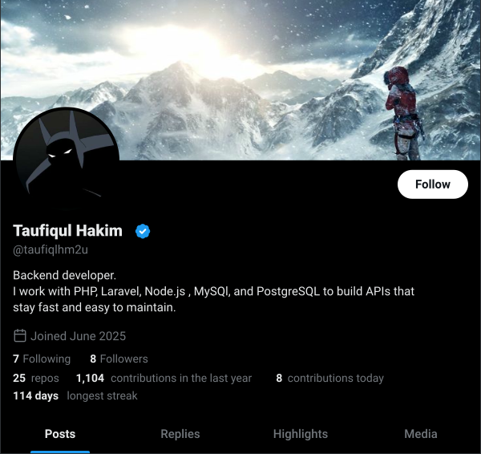
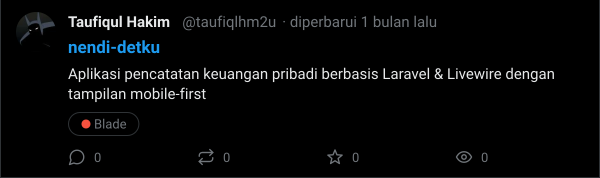
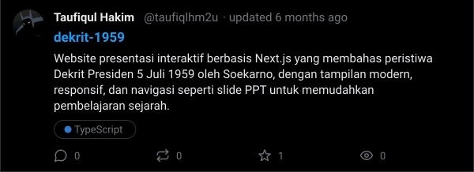
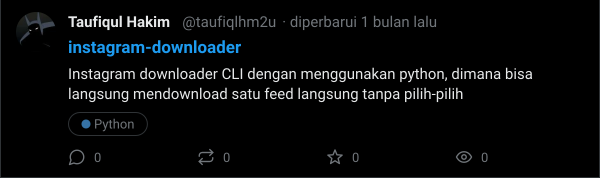
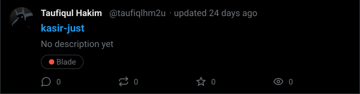
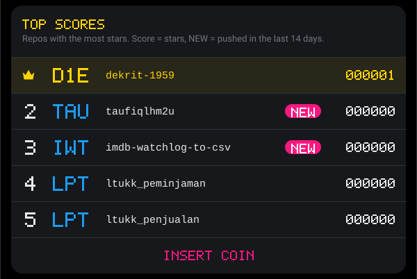
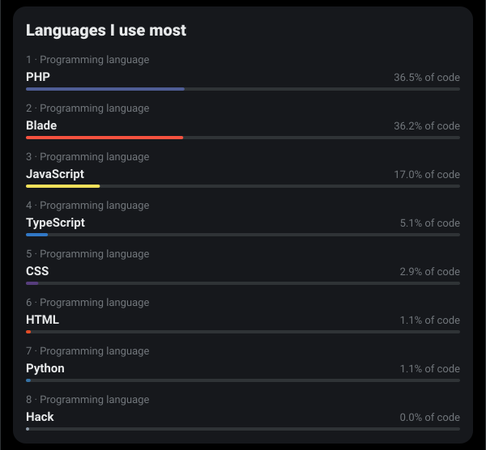
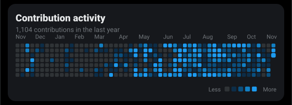

<a href="https://github.com/taufiqlhm2u">
<picture>
  <source media="(prefers-color-scheme: light)" srcset="assets/profile-light.svg" />
  
</picture>
</a>

<a href="https://github.com/taufiqlhm2u/nendi-detku">
<picture>
  <source media="(prefers-color-scheme: light)" srcset="assets/repo-1-light.svg" />
  
</picture>
</a>

<a href="https://github.com/taufiqlhm2u/dekrit-1959">
<picture>
  <source media="(prefers-color-scheme: light)" srcset="assets/repo-2-light.svg" />
  
</picture>
</a>

<a href="https://github.com/taufiqlhm2u/instagram-downloader">
<picture>
  <source media="(prefers-color-scheme: light)" srcset="assets/repo-3-light.svg" />
  
</picture>
</a>

<a href="https://github.com/taufiqlhm2u/kasir-just">
<picture>
  <source media="(prefers-color-scheme: light)" srcset="assets/repo-4-light.svg" />
  
</picture>
</a>

<picture>
  <source media="(prefers-color-scheme: light)" srcset="assets/arcade-light.svg" />
  
</picture>

<picture>
  <source media="(prefers-color-scheme: light)" srcset="assets/arcade-scores-light.svg" />
  
</picture>

<picture>
  <source media="(prefers-color-scheme: light)" srcset="assets/solar-light.svg" />
  
</picture>

<picture>
  <source media="(prefers-color-scheme: light)" srcset="assets/langs-light.svg" />
  
</picture>

<picture>
  <source media="(prefers-color-scheme: light)" srcset="assets/contributions-light.svg" />
  
</picture>

